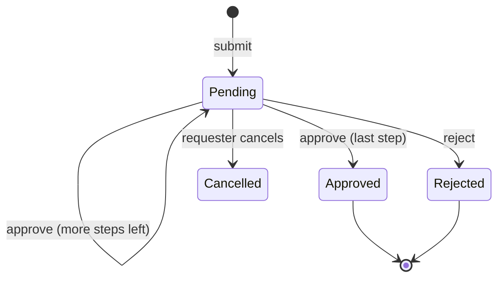
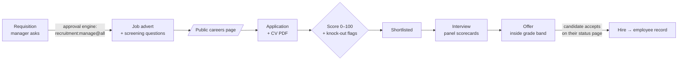

# Kilele HR: design

A web-based, ERP-style HR management system built for the iLabAfrica (Strathmore University) coding challenge set by Charles Wambugu on 4 Nov 2026.

> **Kilele Group Ltd** is a made-up Nairobi company used for the demo data. "Kilele" means "peak" in Swahili.

## 1. Stack

| Layer | Choice | Why |
|---|---|---|
| App | Next.js 16 (App Router) + React 19 + TypeScript | One codebase for UI and server. Server Components read data straight from the database, so no API layer to keep in sync. |
| Styling | Tailwind CSS 4 + lucide-react icons | Quick to build, consistent look. |
| Database | MongoDB + Mongoose 9 | HR records nest naturally (history, contacts, approval steps). Runs on a replica set, so multi-document transactions work. |
| Validation | zod 4 | One schema validates each form on the server and gives typed data. |
| Auth | Own implementation: scrypt password hashes, signed JWT (jose) in an httpOnly cookie | Small, fully explainable, no third-party login service. |
| Local DB | `mongodb-memory-server` replica set, saved to `.mongo-data/` | `npm run db` gives a real MongoDB with no install and no internet, so demo day works even if the Wi-Fi doesn't. Atlas works by changing `MONGODB_URI`. |

## 2. Architecture: three rules

```
Browser ─► Page (Server Component) ─► service function(ctx, input) ─► Mongoose model ─► MongoDB
       └─► Form ─► Server Action ───┘          │
                                               ├─ authorize(ctx, permission, target)
                                               ├─ zod validation
                                               └─ audit.record(...)
```

1. **The UI hides, the server enforces.** Buttons are hidden when you lack a permission, but every read and write goes through a service function in `src/server/services/` that checks permissions itself. Calling a Server Action by hand doesn't get around this.
2. **Every service function takes `ctx`** (who is acting: user, employee record, effective permissions). No hidden globals, so each function is easy to test and audit.
3. **Permissions are never trusted from the cookie.** The cookie holds only the user id and a session version. Roles and permissions are reloaded from the database on every request, so disabling an account or removing a role takes effect immediately.

## 3. Access control: roles plus granular, scoped permissions

### Permissions
A permission is `resource:action`, defined once in `src/lib/permissions.ts`, which is the single source of truth. Examples:

| Area | Permissions |
|---|---|
| Users and roles | `user:read`, `user:manage`, `role:manage` |
| Audit | `audit:read` |
| Employees | `employee:read`, `employee:create`, `employee:update`, `employee.contact:read`, `employee.pii:read`, `employee.pay:read` |
| Organisation | `org:manage` (departments, job grades) |
| Leave | `leave:apply`, `leave:read`, `leave:approve`, `leave:manage` |
| Recruitment | `recruitment:manage`, `application:review`, `interview:score` |
| Movements | `promotion:initiate`, `promotion:approve` |
| Separation | `separation:initiate`, `separation:approve`, `clearance:signoff` |

### Scopes: the "smarter" part
Plain RBAC says *what* you can do. HR also needs to say *to whom*. A line manager can approve leave for their own team, not the whole company. So scoped permissions carry a scope:

| Scope | Covers |
|---|---|
| `own` | Only your own employee record |
| `team` | Everyone who reports to you, directly or indirectly |
| `department` | Everyone in your department |
| `all` | Everyone |

A grant is written `leave:approve@team`. One check, `can(ctx, "leave:approve", employee)`, handles all four scopes. For lists, `scopeFilter(ctx, "employee:read")` turns the same grants into a MongoDB filter, so a manager's employee list query only ever *fetches* their team. It isn't fetched and then hidden.

"Everyone below me" has to be fast, so each employee stores a **materialised path** of their managers (`managerPath: [ceo, cto, teamLead]`). "Is X in my team?" becomes the single indexed query `{ managerPath: myId }`. Changing someone's manager rewrites the path for them and everyone under them.

### Roles
A role is a named bundle of grants, stored in the database and editable by admins through a permission matrix. A user can hold several roles, and their effective permissions are the union. Seeded roles:

| Role | Gist |
|---|---|
| Super Admin | Everything. Can't be deleted. Only a Super Admin can make another one. |
| HR Manager | All HR data including PII and pay; final approvals |
| HR Officer | Employee data and leave processing; no pay; can't edit roles |
| Recruiter | Job requisitions, vacancies, applicants, interviews |
| Line Manager | Team-scoped read, leave approval, initiates promotions and separations |
| Employee | Own record, own leave, self-service |
| Auditor | Read-only audit log and records, no PII |

### Built-in safeguards (separation of duties)
- Nobody approves their own request: the workflow engine refuses it even for a Super Admin.
- You can't grant permissions you don't have yourself, so no privilege escalation via the role editor.
- The last Super Admin can't be disabled or demoted.
- Accounts lock for 15 minutes after 5 failed logins. New accounts get a temporary password that must be changed at first login.

## 4. Employee records and PII protection

### Data classes
Each employee field belongs to a sensitivity class, and each class has a read permission:

| Class | Fields | Needed to see it |
|---|---|---|
| Directory | name, staff no., job title, department, work email, manager, photo | `employee:read` (scoped) |
| Contact | personal phone and email, home address, next of kin, emergency contact | `employee.contact:read` |
| PII | National ID, KRA PIN, NSSF no., SHA no., date of birth, bank details | `employee.pii:read` |
| Pay | basic salary, job grade, pay history | `employee.pay:read` |

Seeing your own record is not a special case in code: the Employee role grants `employee.contact:read@own`, `employee.pii:read@own` and `employee.pay:read@own`, so it shows up in the permission matrix like everything else.

### How it's enforced
1. **One serializer.** Every employee record leaving the server goes through `toEmployeeView(record, ctx)`, which drops or masks fields by class. A masked National ID shows as `••••4821`.
2. **Reveal with a reason.** Even with PII access, sensitive fields start masked. Clicking *Reveal* asks for a reason ("Preparing NSSF returns") and logs it to the audit trail. This follows the Kenya Data Protection Act 2019 principle of purpose limitation: you can show *why* each person viewed each record.
3. **Encrypted at rest.** National ID, KRA PIN, NSSF, SHA, date of birth and bank account are encrypted with AES-256-GCM before they reach MongoDB, so a leaked database dump shows ciphertext. The key comes from the environment, never the database.
4. **Blind index.** Encrypted values can't be searched or kept unique, so we also store an HMAC of the National ID. This catches duplicate IDs and allows exact-match search without decrypting anything. Typing an 8-digit number in the directory search finds that person, but only for users with PII access.
5. **Who looked at what.** Opening someone's profile logs which classes you were shown ("directory, contact, PII (masked), pay"). Opening the PII edit form counts as a view too, because it prefills the real values. Repeat views of the same record within 10 minutes count once, so refreshes don't bury the trail. Reveals with a reason are always logged.
6. **Edits need both rights.** Editing contact details needs `employee:update` *and* `employee.contact:read` for that person, and PII edits need `employee.pii:read`. You can't change what you can't see. Audit entries for contact, PII and pay changes name the fields but never copy the values.
7. **Pay separately.** An HR Officer can add a new hire but not set their salary: the grade's starting pay is used. Salary changes need `employee.pay:update`, must stay inside the grade's band, and can't be made to your own pay. Grade changes only happen through an approved promotion or demotion (M4).

### Employment history as events
Hires, promotions, demotions, transfers, manager changes, salary changes and separations are each saved as an **effective-dated employment event**. The employee's current title, grade and department are a snapshot of the latest event. So the career timeline on the profile is always complete, and nothing is overwritten. Salary figures in the timeline are hidden from anyone without pay access to that person.

### Changing someone's manager
The new `managerPath` is the new manager's path plus the new manager. Everyone below the person inherits it, all in one transaction. Making someone report to a person who is below them would create a loop, so it's refused.

## 5. One approval engine for every module

Leave, promotions/demotions, job requisitions and separations all need "submit → someone approves → maybe someone else approves". Instead of writing that four times, there's **one workflow engine** (`src/server/workflow.ts`). Each request type declares its steps:

```ts
// src/server/services/leave.ts: this is all leave has to say about approvals
export const LEAVE_WORKFLOW: WorkflowDef = {
  steps: [
    { key: "manager", label: "Line manager", approver: { kind: "manager", perm: "leave:approve" } },
    { key: "hr",      label: "HR",           approver: { kind: "permission", perm: "leave:approve", scope: "all" } },
  ],
  distinctApprovers: false,
};
// promotion:   [ manager, hr(promotion:approve@all) ], distinctApprovers: true   (M4)
// requisition: [ hr(recruitment:manage) ]                                      (M3)
// separation:  [ manager, hr(separation:approve@all) ], then clearance          (M4)
```



- **Manager step:** it goes to the *nearest manager up the reporting line who actually holds the permission* for this employee. A team lead without approval rights is passed over to their boss. If nobody qualifies (e.g. the CEO), the step is skipped and the trail says why. The approver is fixed when the request is submitted, so the trail can say "Waiting for Collins Waweru".
- **Permission step:** it goes to anyone holding that permission *at that scope*. A line manager holds `leave:approve@team`, which covers the manager step but not the HR step (`@all`). The same permission at different scopes separates the two jobs.
- **Rules:** nobody decides their own request, whatever their role. Rejecting needs a reason the employee can read. With `distinctApprovers`, each step needs a different person (separation of duties for promotions). Without it, if the person who just approved is also the next approver (Grace is Kevin's manager *and* HR), one click approves both steps and the trail records both.
- **Two approvers at once:** the save only succeeds if the step is still the one they looked at (`updateOne` filtered on `workflow.current`). The second click gets "someone else just decided this", so it can never be approved twice.
- **One inbox:** each request stores who it's waiting for (`pendingWith`), so *My Approvals* is one indexed query per request type. Modules register in `services/approvals.ts`, and leave is the first.
- Every decision is saved on the request (who, when, comment) and in the audit trail.

### Leave rules (Kenya, Employment Act 2007)
| Type | Default | Counted in | Notes |
|---|---|---|---|
| Annual | 21 days | working days | Pro-rata for joiners; up to 5 days carry over |
| Sick | 14 days | working days | After 2 months' service; can be logged 7 days late |
| Maternity | 90 days | calendar days | Women |
| Paternity | 14 days | calendar days | Men |
| Compassionate | 5 days | working days | Company policy (not in the Act) |
| Study / exam | 10 days, unpaid | working days | After 12 months; company policy |

- **Working days** skip weekends and public holidays. Fixed holidays and Easter are calculated (`lib/leaveDays.ts`), and a Sunday holiday moves to the Monday. Eid and one-off gazetted days are added by HR in Leave settings. The browser previews the count with the same function the server uses to decide.
- **Balances are never stored:** entitlement + carry-over + HR adjustments − approved − pending, worked out on every read. Pending days are reserved, so you can't apply twice for the same days. Cancelling just changes the status, and the days come back automatically.
- **Checked on apply:** overlapping requests, enough balance, eligibility (gender, months of service), no past dates (except sick leave's 7-day window), no crossing into a new year, and no weekend-only requests. Each application takes a per-employee lock inside a transaction, so two simultaneous requests can't both spend the same days.

### Recruitment: from "we need someone" to an employee record

- **Headcount is approved before anything is advertised.** A requisition goes through the same approval engine as leave (one step, Talent & HR). Managers can only request hires for their own department, and nobody approves their own request. The approved requisition fixes the title, grade and department, so the advert can't quietly change them.
- **The careers site is public**, so it's defended: rate-limited per IP, a hidden honeypot field for bots, PDF-only CVs (checked by the file's first bytes, not its name), one application per email per job, a 2 MB limit, and a consent statement under the Data Protection Act with a stated 12-month retention. It asks only for what recruitment needs: no ID numbers until someone is hired.
- **Screening scores, but doesn't decide.** Each question has a weight. Yes/no and number answers become a 0–100 score (`lib/screening.ts`, pure and unit-tested). A missed must-have *flags* the candidate rather than auto-rejecting them, because rejecting is a human decision and edge cases matter. Weight 0 means "for information only" (e.g. salary expectation).
- **The pipeline is a state machine.** Only defined moves are allowed (new → shortlisted → interview → offer → accepted → hired, plus rejected, withdrawn or declined), and every move is in the history and the audit trail. Rejecting needs a reason.
- **Blind scorecards.** Interviewers can't see colleagues' scores until they've submitted their own (hiring manager included), so the first opinion heard doesn't anchor the rest. Scorecards can't be edited after submitting.
- **Offers stay inside the grade's salary band** and need `recruitment:manage`.
- **The candidate has a private status page.** The link holds a random token, and we store only its hash, so even a database leak can't rebuild the links. It shows their stage, interview time and place, and the offer to accept or decline, but never scores, notes or interviewers' names.
- **Hire = no retyping.** HR adds what's collected on the first day (ID, KRA PIN…). Job, grade, department, manager, start date and the *offer's* salary carry over through the same `createEmployee()` used everywhere. An HR Officer without pay rights can still onboard, because the salary was already approved in the offer. The vacancy is marked filled when every opening is hired.
- **CVs live in MongoDB (GridFS)**: no extra storage service, backed up with the database, and it works offline. Opening a CV is audited.

### Promotions and demotions
- **Proposed** by anyone holding `promotion:initiate` for that person (a line manager for their team, HR for everyone), never for themselves. A higher grade is a promotion, a lower one a demotion, and a title change on the same grade is just a profile edit.
- **Approved by two different people** (`distinctApprovers: true`): first the nearest manager *above the proposer* (the engine skips whoever submitted the request, so Collins' proposal for Mercy goes to David), then HR (`promotion:approve@all`).
- **Pay without seeing pay.** A line manager can't see salaries, so they can't type one. The pay moves into the new grade's band automatically: at least the new minimum on promotion (never a cut), capped at the new maximum on demotion. Someone with pay rights for that person can set a figure inside the band.
- **Effective dates are respected.** On final approval the change is applied at once if its date has come. Otherwise it waits as *Scheduled*, and the scheduled job applies it on the day. Either way it writes the employee record and an employment event in one transaction.

### Exits (separation)
- **Started by** the employee (resignation only, via *Resign* on their profile), their manager, or HR (any kind: resignation, retirement, termination, end of contract). Terminations need a full written reason. A notice shorter than 28 days (Employment Act s.35) is flagged for pay in lieu.
- **Approved by** the line manager, then HR (two different people).
- **Clearance:** on approval, a checklist is created. Each item belongs to a department (IT gets the laptop back and switches off access, Finance settles loans and final dues, HR collects the badge and issues the certificate of service required by s.51, the leaver's own department confirms handover). Only someone *in that department* with `clearance:signoff` can sign an item, and never the leaver. Unused annual leave is shown for the final dues.
- **Exit interview:** the leaver rates five areas and says why they're leaving. The answers are visible to HR only, not the manager, so people can be honest. The audit trail records *that* it was submitted, not what was said.
- **Completion:** when everything is signed and the last day has come, in one transaction the employee is marked separated, a separation event is added to their history, and their login is disabled with every session invalidated. Upcoming retirements (60th birthday within 12 months) are listed for HR, with a one-click *Start retirement*.

### The scheduled job (`src/server/jobs.ts`)
Some things happen on a date, not on a click: a promotion's effective date, an exit's last day. `src/instrumentation.ts` starts `runDueJobs()` when the server boots, then every 10 minutes. Every step is **idempotent**: it claims the record with a conditional update (`appliedAt: null` → now, `completedAt: null` → now), so two runs at once, or the job and a click at once, still apply each change exactly once. It also catches up on any approval hook that failed. In production with several servers, this would move to one cron worker.

## 6. Modules

| # | Module | What it does |
|---|---|---|
| 1 | **Access control** | Users, roles, permission matrix with scopes, account lock and unlock, forced password change, session revocation |
| 2 | **Employee records** | Directory with search and filters, profile tabs (overview, contact, PII, pay, history, documents), create and edit wizard, org chart |
| 3 | **Recruitment** | Job requisition (approved) → vacancy → public careers page → online application with CV → knockout questions and scoring → shortlist → interview panel scorecards → offer → **hire converts the applicant into an employee**, no retyping |
| 4 | **Leave** | Kenyan Employment Act defaults: annual 21 days, maternity 90 days, paternity 14 days, sick leave, compassionate leave. Counts working days only (skips weekends and Kenyan public holidays), blocks overlapping requests, shows live balances, team leave calendar |
| 5 | **Promotions and demotions** | Manager proposes new title, grade and salary with a justification → approval → employment event on the effective date |
| 6 | **Separation** | Retirement, resignation, termination. Upcoming retirements flagged (age 60). Approval → clearance checklist where each department signs off (IT gets the laptop back, Finance settles dues) → exit interview → on completion the login is disabled automatically |
| + | **Audit trail** | Every change and every PII view, hash-chained so tampering shows up |
| + | **Dashboard** | Headcount, leave today, open vacancies, pending approvals, upcoming retirements |

## 7. Audit trail

Every write, every PII reveal, every sign-in (and failed sign-in) and every refused attempt (`access.denied`) appends an entry: who, what, which record, which fields changed, the reason, IP address, and time. Changed **values** of PII fields are never copied into the log, only the field names, so the log doesn't become a second copy of the sensitive data.

Entries are **hash-chained**, the same idea as the E-ELECTIONS ballot ledger: each entry stores `hash = SHA-256(previous hash + entry contents)`. The *Verify chain* button recomputes the chain and points to the first entry that was edited or deleted. A unique index on the sequence number stops two simultaneous writes from forking the chain.

## 8. Data model (collections)

| Collection | Key fields |
|---|---|
| `users` | email, passwordHash, roleIds[], extraGrants[], employeeId?, status, sessionVersion, failedLogins, lockedUntil, mustChangePassword |
| `roles` | name, description, grants[] (e.g. `leave:approve@team`), system |
| `departments` | name, code, headId |
| `employees` | staffNo, names, workEmail, jobTitle, grade (G1–G8, salary bands in `lib/grades.ts`), departmentId, managerId, managerPath[], status, hireDate, contact{}, pii{ encrypted }, nationalIdHash, pay{}, retirementDate |
| `employmentEvents` | employeeId, type (hire/promotion/demotion/transfer/salary/separation), effectiveDate, from{}, to{}, requestId |
| `leaveTypes` | code, name, daysPerYear, paid, gender rule, needs attachment |
| `leaveRequests` | employeeId, type, start, end, days, reason, workflow{} |
| `requisitions` | number, title, department, grade, openings, justification, hiringManagerId, vacancyId, workflow{} |
| `vacancies` | slug, requisitionId, advert text, closesOn, status, questions[] (weights, knock-outs), criteria[], hired / openings |
| `applications` | number, vacancyId, candidate{}, answers[], score, knockouts[], cvFileId (GridFS), stage, history[], interviews[{panel[], scorecards[]}], offer{}, statusTokenHash, consentAt, employeeId |
| `cvs.files` / `cvs.chunks` | CV PDFs (GridFS) |
| `movements` | number, kind (promotion/demotion), employeeId, from{title, grade, pay}, to{…}, salaryChosen, effectiveDate, justification, appliedAt, workflow{} |
| `separations` | number, kind, employeeId, lastDay, reason, clearance[{department, item, signedBy, signedAt}], exitInterview{} (HR-only), completedAt, workflow{} |
| `movementRequests` | employeeId, kind (promotion/demotion), from{}, to{}, justification, workflow{} |
| `separations` | employeeId, kind, lastDay, workflow{}, clearance[], exitInterview{} |
| `auditLogs` | seq (unique), at, actor, action, entity, entityId, changes[], reason, ip, prevHash, hash |

## 9. Milestones to demo day

Weekly check-ins with Charles (proposed Fri 5pm). Each milestone ends with the app running on seeded demo data.

| Check-in | Milestone | Shows |
|---|---|---|
| Fri 6 Nov | **M0: Foundation** ✅ built 4 Nov | This design, login, roles, permission matrix, users, audit log with hash chain |
| Fri 13 Nov | **M1: People** ✅ built 4 Nov | Employee directory, profiles, PII masking and reveal, encryption at rest, org chart, employment history |
| Fri 20 Nov | **M2: Leave and approvals** ✅ built 4 Nov | Workflow engine, My Approvals inbox, leave types, balances, calendar |
| Fri 27 Nov | **M3: Recruitment** ✅ built 4–5 Nov | Requisition → careers page → apply → shortlist → interview → hire |
| Fri 4 Dec | **M4: Movements and exits** ✅ built 5 Nov | Promotions/demotions, separation with clearance and exit interview, dashboard, polish, demo script rehearsal |
| Early Dec | **Demo day at Strathmore** | 10-minute live demo (`docs/DEMO.md`) |

## 10. Out of scope (would come next)
- **Payroll** (PAYE, NSSF, SHIF, Housing Levy). The pay data, grades and events are ready for it.
- **Notifications** by email or SMS (e.g. Africa's Talking) for "waiting for your approval" and candidate updates.
- **Two-factor login** for HR and admin roles.
- **Delegation:** an approver on leave hands their inbox to a deputy for a date range (the engine already routes by rules, so it's one more rule).
- **Data retention job:** delete unsuccessful applications and CVs after 12 months, as the consent text promises. It would run in the same scheduled job.
- **Performance reviews**, and a mobile app.

The auth, audit, encryption and approval-engine pieces are reusable for the second challenge, the Whistleblower Protection App.
